## Password Cracking & Hash Extraction Phases

**W3- PM1 & PM2 | CYBERSECURITY | NETWORKWALKS**

| Field | Detail |
| :--- | :--- |
| **Pentester Name** | **Muhammad Trisna Zanuar Rahmadan Nur Faisal Hadi Saputra** |
| **Program/Batch** | B084-Networkwalks |
| **Date** | 21 November 2026 |
| **Modules completed** | W3-PM1 (John the Ripper / Johnny GUI)<br>W3-PM2 (Password Cracking with Networkwalks Tools) |
| **Client/Target** | 1. Networkwalks (secured written permission already)<br>2. Authorized Lab Sample Files (`My Locked PDF1.pdf`) |
| **Permission secured from client?** | Yes |
| **Phases covered** | **Phase 1:** Hash Extraction & Format Conversion<br>**Phase 2:** Local Dictionary Attack (John the Ripper / Johnny)<br>**Phase 3:** Web-Based Dictionary Attack (Networkwalks Tools)<br>**Phase 4:** Document Decryption & Flag Verification |

---

# 1. Liability Disclaimer

I have performed these activities only on the files & systems where I had secured written permission or the devices/files that I own myself. All these materials are for education and research purposes only. Do not use these techniques on unauthorized files or systems without explicit permission.

---

# 2. Theoretical Background & Tool Overview

### What is Password Cracking?
Password cracking is the process of recovering a plaintext password from stored data or a password-protected file. Security professionals perform password auditing to evaluate password strength and demonstrate the risks of using weak, short, or predictable passwords.

### Encryption vs. Hashing
* **Encryption:** A two-way cryptographic function where plaintext is converted into ciphertext using a key and can be decrypted back to plaintext with the proper key.
* **Hashing:** A one-way cryptographic function that transforms plaintext into a fixed-length scrambled string (message digest/hash). Protected files like PDFs do not store passwords in plaintext; instead, they store cryptographic hashes (e.g., `$pdf$...`).

### What is John the Ripper (JTR)?
**John the Ripper** is a widely used, open-source offline password-cracking tool. It supports hundreds of hash formats and utilizes attack modes such as **Dictionary Attacks** and **Brute-Force Attacks** by hashing candidate words from a wordlist and comparing them against the target hash. **Johnny** serves as the cross-platform graphical user interface (GUI) frontend for the John the Ripper CLI engine.

---

# 3. Methodology 1: Local Password Cracking (John the Ripper & Johnny GUI)

### Step-by-Step Execution:
1. **Engine Setup & Configuration:**
   * Installed **Johnny GUI** alongside the **John the Ripper (Jumbo CLI)** distribution.
   * 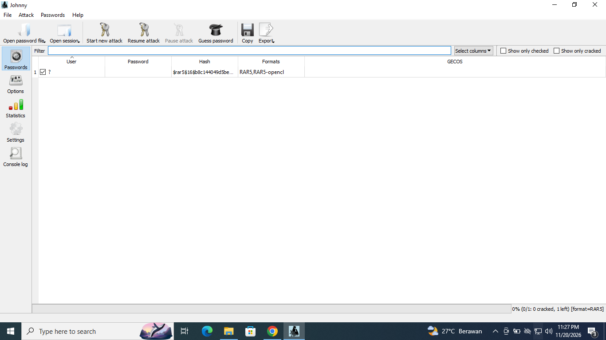

   * Linked Johnny to the core executable binary (`john.exe` inside the `/run` directory) to enable local hash processing.
   * 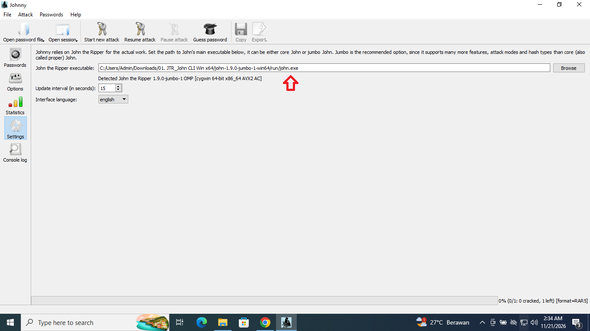


1. **PDF Hash Extraction:**
   * Extracted the cryptographic hash string from the encrypted target document (`My Locked PDF1.pdf`) using a `pdf2john`-compatible extractor, generating a string starting with `$pdf$4*4*128*...`.
   * 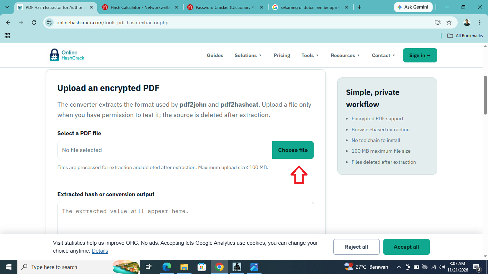
   * 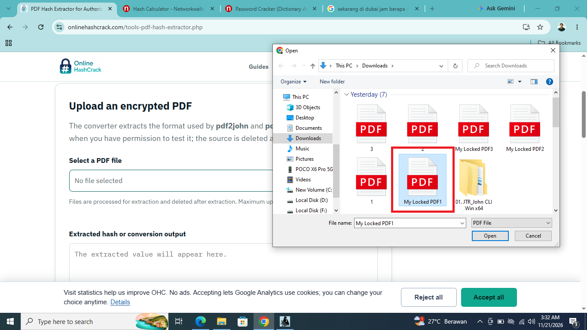

   * Saved the extracted hash string into a plain text file named `hash1.txt`.
   * 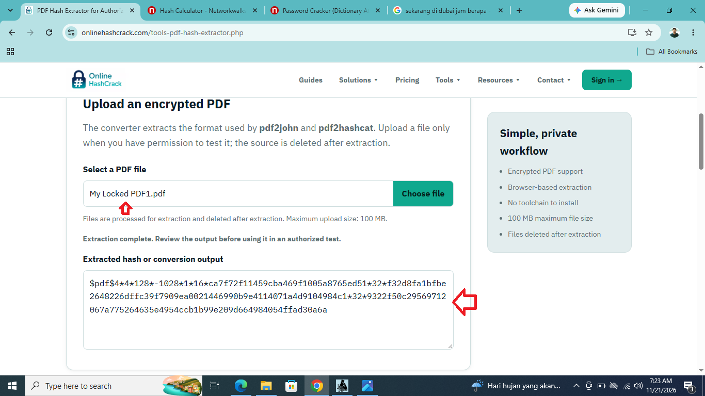


2. **Executing the Attack in Johnny:**
   * Loaded `hash1.txt` into Johnny via **Open password file** (`PASSWD` format).
   * 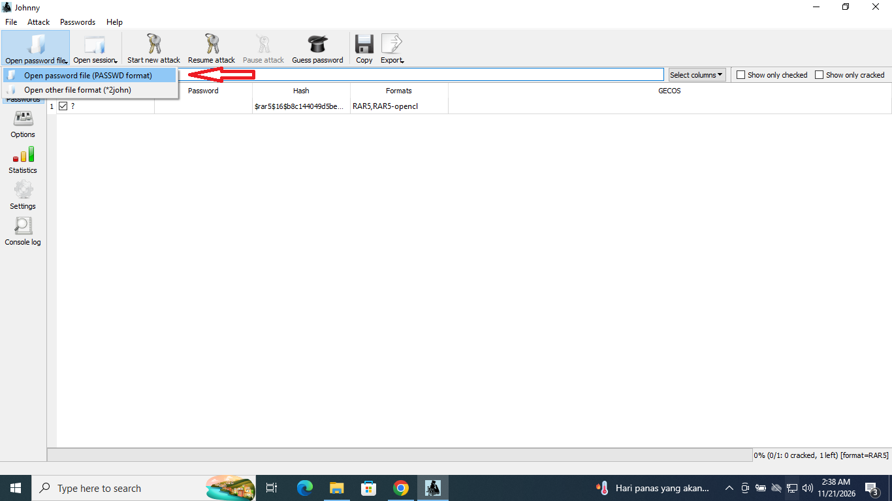

   * Initiated the cracking session by clicking **Start new attack**.
3. **Result & Verification:**
   * John the Ripper successfully matched the hash against its wordlist and recovered the plaintext password: `good-luck`.
   * 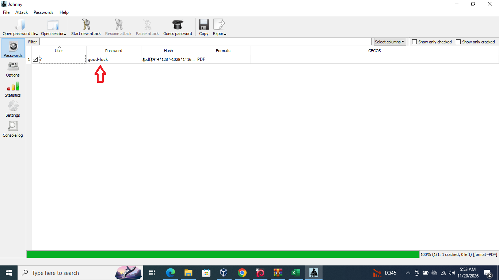
     


---

# 4. Methodology 2: Web-Based Cracking (Networkwalks Tools)

To demonstrate browser-based offline/local parsing workflows without local CLI installations, the second part of the module utilized Networkwalks' browser tools:

### Step-by-Step Execution:
1. **Hash Extraction via Networkwalks Hash Calculator:**
   * Accessed the [Networkwalks Hash Calculator](https://networkwalks.com/hash-calculator/).
   * 

   * Uploaded the encrypted file `My Locked PDF1 (for NW Tools Lab WK3-PM2).pdf`, which parsed the file locally in the browser and generated the `pdf2john`/`hashcat`-compatible `$pdf$...` hash string.
   * 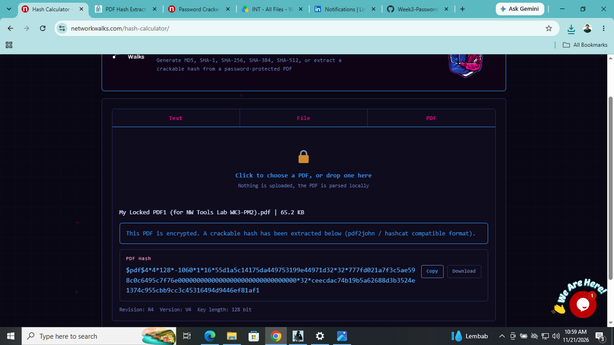

   * Copied the complete hash value.
   * 

2. **Dictionary Attack via Networkwalks Password Cracker:**
   * Opened the [Networkwalks Password Cracker](https://networkwalks.com/password-cracker/).
   * 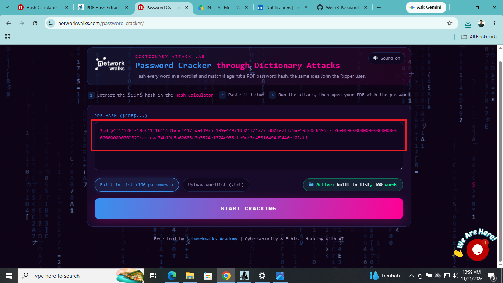

   * Pasted the extracted `$pdf$...` hash into the **PDF HASH** input field.
   * Selected the **Built-in list** wordlist and clicked **START CRACKING**.
   * 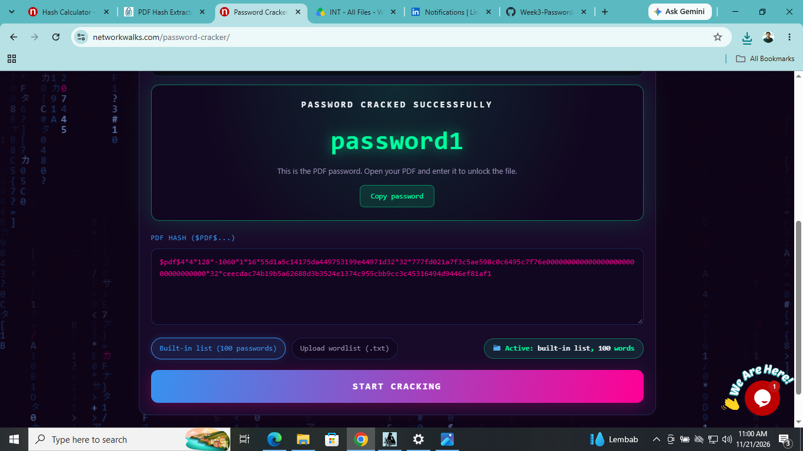

3. **Document Unlocking & Flag Capture:**
   * Once the dictionary attack succeeded, used the recovered password to unlock the protected PDF document.
   * Verified access by capturing the lab completion flag inside the document:
     ```text
     nw{networkwalks_flag1_jtr_270521_1}
     ```
     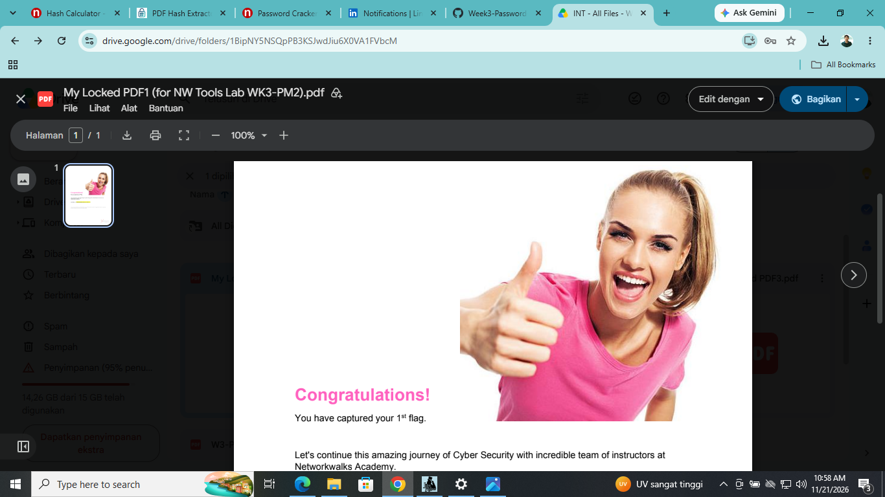

    

---

# 5. Key Takeaways & Remediation

* **Vulnerability:** Weak or dictionary-based passwords protecting sensitive documents can be recovered within seconds once the cryptographic hash is extracted.
* **Remediation:** Enforce strong password policies (minimum 12+ characters combining uppercase, lowercase, numbers, and special symbols) and utilize modern AES-256 encryption standards for sensitive documents.

